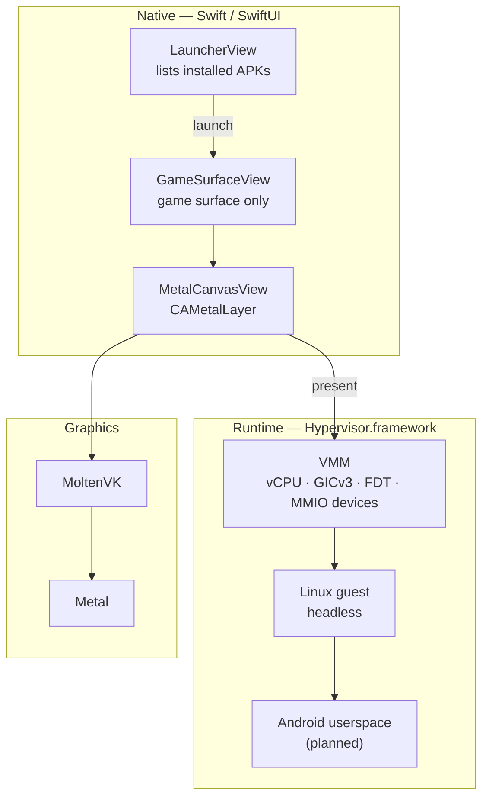

# PearDroid

**An Android compatibility layer for Apple silicon — headless Android, native surface.**

PearDroid runs Android *without* an Android UI. There is no SystemUI, no home
screen and no emulator window: a native SwiftUI launcher lists installed apps and,
when one is launched, only that app's surface is shown. Graphics are translated
from Vulkan to Metal with **MoltenVK**, and the Linux/Android guest runs on a
small VMM built directly on **Hypervisor.framework** — the same foundation
OrbStack uses.

> **Project status: early but functional.** The macOS graphics path, the native
> launcher and the hypervisor-based runtime are implemented and verified. A
> minimal Linux guest now boots to userspace init under PearDroid's own VMM.
> Android userspace and the guest→surface bridge are the remaining work.

---

## Status

| Component | State |
| --- | --- |
| Vulkan ➜ Metal surface via MoltenVK | ✅ verified |
| SwiftUI launcher (APK list, game-surface-only presentation) | ✅ verified |
| APK inspection — ZIP, binary `AndroidManifest.xml`, `resources.arsc` | ✅ verified on real APKs |
| Guest execution on Hypervisor.framework | ✅ verified |
| VMM — MMIO devices, PL011 console, PSCI, GICv3, arch timer, FDT | ✅ verified |
| **Headless Linux boot to userspace `init`** | ✅ verified |
| Interactive console (`ttyAMA0`) / shell | 🚧 in progress |
| Android userspace container | ⬜ planned |
| Guest ➜ `CAMetalLayer` surface bridge | ⬜ planned |
| iOS target | ⬜ not feasible (platform limits) |
| Play Integrity / SafetyNet spoofing | ✖ deliberately out of scope |

### Verified boot

A minimal arm64 Linux guest, booted by `tools/vmmboot` on Hypervisor.framework:

```
Booting Linux on physical CPU 0x0000000000 [0x610f0000]
Machine model: linux,dummy-virt
earlycon: pl11 at MMIO 0x0000000009000000
psci: PSCIv1.1 detected in firmware.
arch_timer: cp15 timer running at 24.00MHz (virt).
SMP: Total of 1 processors activated.
Memory: 240928K/262144K available
Freeing unused kernel memory: 1152K
Run /init as init process
```

The GPU path is likewise verified: a Vulkan triangle is rendered through MoltenVK
into a `CAMetalLayer` at 60 fps inside a SwiftUI window.

---

## Architecture



**Not an emulator.** Like Proton and Waydroid, PearDroid aims to be a translation
and compatibility layer rather than a full machine emulator. Today the graphics
translation, packaging/launch layer and hypervisor runtime are real; Android
userspace is the remaining piece.

**Headless by design.** Android is never asked to draw a UI. The only surface that
would ever exist is the launched app's own.

---

## Quick start

Requirements: macOS on Apple silicon, Xcode command line tools, and Homebrew.

```sh
brew install molten-vk vulkan-headers vulkan-loader shaderc

make            # compile shaders + build build/PearDroid.app
make run        # run in the foreground (renderer logs visible)
make open       # launch through LaunchServices
make clean
```

### Using the launcher

1. Put `.apk` files in `~/Library/Application Support/PearDroid/apks/`
   (*Open APK folder* in the empty state takes you there).
2. Press **Rescan**, then **Launch**.
3. Or open a package directly:

```sh
build/PearDroid.app/Contents/MacOS/PearDroid --apk ~/Downloads/app.apk
```

---

## Components

### Native app (`Sources/PearDroid`)

- **`App/`** — SwiftUI shell, renderer/runtime status, logging.
- **`Vulkan/`** — `VulkanRenderer` and the Swift ⇄ Vulkan bridge. Links MoltenVK
  directly (no loader, no proc-address trampolines).
- **`Launcher/`** — APK discovery and presentation:
  - `ZipReader` — minimal ZIP reader (raw DEFLATE via Apple's Compression).
  - `AndroidBinaryXML` — parser for the compiled `AndroidManifest.xml`.
  - `AndroidResources` — resolves an `android:label` reference against
    `resources.arsc`, so the launcher shows real app names rather than package ids.

### Tools (`tools/`)

| Tool | Purpose |
| --- | --- |
| `hvprobe` | Confirms Hypervisor.framework works under ad-hoc signing. |
| `vmm` | Device-model core: runs guest code, emulates a PL011 over MMIO faults, handles PSCI/HVC. |
| `vmmboot` | Full boot path: GICv3, device tree, kernel + initramfs loading, arch timer. |
| `vmprobe` | The earlier `Virtualization.framework` experiment (kept for reference; cannot start a guest because that entitlement rejects ad-hoc signatures). |

Each tool is a single `main.swift` compiled with `swiftc`; see
[`docs/RUNTIME.md`](docs/RUNTIME.md) for the commands and design.

---

## Technical notes

These are the non-obvious things that had to be right for the guest to boot.

- **Handles.** On 64-bit platforms Vulkan defines *every* handle as an opaque
  pointer, so in Swift they all import as `OpaquePointer` and creation calls take
  `UnsafeMutablePointer<VkFoo?>`.
- **Bridging header.** The Clang importer parses it in Objective-C mode, which
  would make `VkMetalSurfaceCreateInfoEXT` non-trivial; the header `#undef`s
  `__OBJC__` while including Vulkan so it stays a plain C record.
- **UTF-8 string pools** in `resources.arsc` store *two* length prefixes (UTF-16
  code units, then UTF-8 bytes).
- **Device tree offsets** are relative to the start of the blob, not to the
  body after the header.
- **GICv3 redistributors** need `#redistributor-regions` and a region sized for
  the vCPU count — describing the implementation's whole supported region (32 MB)
  makes the kernel compute a bad base.
- **Kernel alignment.** The arm64 boot protocol wants the image at a 2 MiB-aligned
  address (`[Firmware Bug]: Kernel image misaligned` otherwise).
- **Entry point.** Distro `vmlinuz` files are EFI images (`code0` is `MZ`, not a
  branch) or EFI-zboot; a kernel built with `make Image` exposes the direct
  branch, and `code1` reaches `primary_entry`.
- **EL2 traps** debug system registers; `OSLAR_EL1` must be handled or the guest
  faults during CPU bring-up.

---

## Repository layout

```
Sources/PearDroid/
  App/        SwiftUI shell, status, logging
  Vulkan/     Vulkan bridge + renderer (MoltenVK)
  Launcher/   APK/zip/manifest/resource parsing, launcher and surface views
shaders/      GLSL for the demo triangle (SPIR-V via glslc)
scripts/      build.sh
Resources/    Info.plist, entitlements.plist
tools/        hvprobe, vmm, vmmboot, vmprobe
docs/         RUNTIME.md — runtime design and verified findings
```

Build output (`build/`) and generated SPIR-V are ignored; verification artefacts
are intentionally not committed.

---

## Roadmap

1. **Interactive console** — make `ttyAMA0` probe correctly so the guest gives a
   real shell.
2. **Block/console devices** — virtio-blk (disk rootfs) and/or virtio-console.
3. **Android userspace** — a Waydroid-style container inside the guest
   (`CONFIG_ANDROID_BINDER_IPC`).
4. **Surface bridge** — hand the guest framebuffer to the host `CAMetalLayer`.
5. **Input bridge** — keyboard/pointer from the SwiftUI surface into the guest.
6. **Launcher integration** — install/launch over a control channel.

---

## Scope & limitations

- **macOS on Apple silicon only.** iOS has no hypervisor API for third-party apps,
  no arbitrary JIT and no process spawning, so a general Android runtime cannot be
  built there.
- **Not a full emulator**, and not a from-scratch AOSP port. The guest is a
  minimal virtualised kernel plus userspace, in the Waydroid tradition.
- **Anti-cheat is out of scope.** PearDroid does not attempt to fake Play
  Integrity or SafetyNet attestation. Defeating a security control is not
  something this project does, and hardware-backed attestation cannot be forged
  in software by design. If an app declines to run in a compatibility layer, that
  is its policy working as intended.
- **Performance** depends on the surface bridge; a shared-memory path is the goal
  for near-native presentation.

---

## Licence

Licence to be determined before distribution. MoltenVK, the Vulkan headers and
the Linux kernel retain their own licences (Apache-2.0 / MIT / GPL-2.0).
